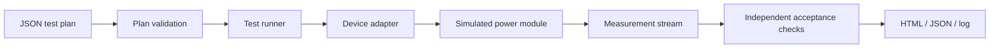

# Automated Electronics Validation Bench

**Automated test sequencing, fault injection, and engineering verification in Python.**

This project implements a configurable validation framework for a **simulated 5 V power-control module**. It executes test plans, acquires time-series voltage, current and temperature measurements, evaluates acceptance criteria independently of the device model, and generates traceable test reports.

The focus is on the engineering workflow used in electronics test and validation: **define requirements → control the test → capture measurements → evaluate results → report evidence**. A simulated device makes the entire workflow reproducible without laboratory equipment.

## What the system demonstrates

- **Automated test execution:** versioned JSON test plans define load, thermal conditions, sample intervals, expected device state and electrical limits.
- **Electronic protection verification:** load-dependent voltage regulation, first-order thermal behaviour, current-limit and overtemperature shutdown are exercised through deterministic scenarios.
- **Fault injection:** voltage/current measurement biases and bypassed protection validate that the checks detect meaningful out-of-spec conditions.
- **Acquisition robustness:** transient and persistent timeouts, invalid telemetry and unexpected device states are handled with separate test and acquisition error outcomes.
- **Traceable results:** measured values, scenario checks and configuration hashes are recorded in JSON; a standalone HTML report and an execution log support review.
- **Maintainable architecture:** a replaceable device interface separates test sequencing from the simulated instrument and device logic.

## Results

The test suite and three included demonstration plans were executed successfully. **Deliberate FAIL and ERROR outcomes are expected** and confirm that the framework distinguishes specification violations from measurement/communication problems.

| Demonstration | Result | Example report |
|---|---|---|
| Nominal and protection testing | **7 PASS** | [HTML](examples/acceptance/report.html) · [JSON](examples/acceptance/report.json) |
| Injected electrical faults | **1 PASS, 3 FAIL** (correctly detected) | [HTML](examples/injected_faults/report.html) · [JSON](examples/injected_faults/report.json) |
| Acquisition faults and recovery | **2 PASS, 3 ERROR** (correctly classified) | [HTML](examples/recovery/report.html) · [JSON](examples/recovery/report.json) |

**Automated verification:** 29 Python unit/integration tests passed. The project includes a GitHub Actions workflow for repeatable checks. See [verification and evidence](docs/VERIFICATION.md) for details.

## Architecture



Each test scenario uses a fresh device adapter. The runner controls the lifecycle (`connect`, `configure`, `sample`, `safe_shutdown`, `close`) and separately classifies valid out-of-limit measurements as **FAIL** and invalid acquisition or execution as **ERROR**.

The device model uses a 5 V nominal output, 0.07 V/A load droop, a simple first-order temperature response, and latched shutdown at 2 A or 80 °C. These parameters are defined **simulation assumptions**, not measurements or specifications of a physical product. Implementation and interface details are in [architecture](docs/ARCHITECTURE.md) and [test plans and adapters](docs/PLAN_AND_ADAPTER.md).

## Run on Windows (PowerShell)

**Prerequisite:** Python 3.11 or newer. No third-party packages are needed.

From the repository folder:

```powershell
python --version
python -m unittest discover -s tests -v
python -m validationbench --plan plans/acceptance.json --output-dir reports/acceptance
Start-Process .\reports\acceptance\report.html
```

Run the diagnostic scenarios:

```powershell
python -m validationbench --plan plans/injected_faults.json --output-dir reports/injected_faults
python -m validationbench --plan plans/recovery.json --output-dir reports/recovery
```

**Exit codes:** `0` = all scenarios passed; `1` = at least one expected or unexpected specification FAIL; `2` = acquisition/processing ERROR. The two diagnostic plans intentionally return non-zero exit codes as a demonstration of fault detection and error classification.

If your system uses the Windows Python launcher, replace `python` with `py -3`.

## Repository guide

| Location | Purpose |
|---|---|
| [`validationbench/`](validationbench/) | Test plan models, simulated device, runner, reporting and CLI |
| [`plans/`](plans/) | Nominal, fault-injection and acquisition/recovery scenarios |
| [`tests/`](tests/) | Unit, boundary, error-handling and CLI tests |
| [`examples/`](examples/) | Reproducible HTML and JSON example reports |
| [`docs/ARCHITECTURE.md`](docs/ARCHITECTURE.md) | Software components, simulation model and design decisions |
| [`docs/PLAN_AND_ADAPTER.md`](docs/PLAN_AND_ADAPTER.md) | Configuration schema and device interface |
| [`docs/VERIFICATION.md`](docs/VERIFICATION.md) | Test methodology and recorded results |

## Engineering scope

The Automated Electronics Validation Bench is a Python-based test framework featuring configurable test plans, automated measurement verification, boundary and protection testing, fault injection, and structured HTML/JSON reporting. The system uses a simulated electronic device and a modular adapter architecture designed to support future integration with physical test instruments.

Licensed under the [MIT License](LICENSE).
