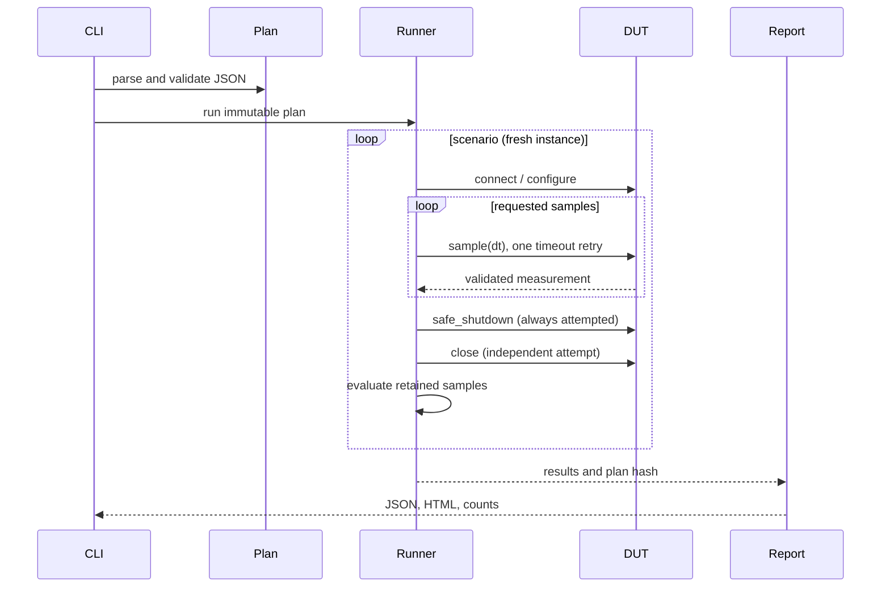

# Architecture, algorithms and engineering assumptions

## Separation of responsibilities

`model.py` defines frozen `Limits`, `Scenario`, `Plan` and `Measurement` dataclasses. `strict` rejects undeclared fields and converts missing-argument errors into configuration errors. `load_plan` rejects duplicate JSON keys and non-standard NaN/Infinity literals. Numeric checks exclude booleans (which Python otherwise treats as integers), nonfinite numbers and out-of-range values. A plan holds a tuple of scenarios and a separate limits record. Configuration never controls the physical simulator trip thresholds: an erroneous acceptance limit must not change DUT behaviour.

`device.py` defines the structural `DUT` protocol, `CommunicationError` and the only implemented adapter, `SimulatedDUT`. The adapter owns connected/enabled state, current scenario, virtual clock, temperature and the latched trip reason. The protocol is an integration boundary, not a claim that physical equipment is supported.

`runner.py` owns sequencing and pass/fail policy. It constructs a fresh adapter per scenario so an earlier injected fault cannot silently contaminate the next scenario. Acquisition exceptions are caught at the scenario boundary and represented as ERROR, preserving existing valid readings. `KeyboardInterrupt` and `SystemExit` are not swallowed; `finally` still attempts cleanup. A timeout on a read triggers at most one retry per requested sample. Configure/start writes are never retried because their completion might be ambiguous. For the simulation, a timeout does not advance virtual time. A physical adapter must define equivalent sample identity semantics or change the retry policy.

`evaluate` is an independent acceptance oracle: it does not ask the simulator whether it passed. Every sample is checked against plan expectations. `summarize` counts PASS, FAIL and ERROR separately. `report.py` emits strict JSON (`allow_nan=False`) and escapes every dynamic HTML field. `__main__.py` maps results to CLI status and attaches a file logging handler for the run, removing and closing it afterward.

## Data flow

## Simulated physics and timing

The module has a 5 V nominal output and 0.07 V/A load droop. Applied load is a commanded current demand, not a resistor model: it does not decrease with voltage. Active current is the applied load; disabled current and voltage are exactly zero. No leakage or discharge dynamics are modelled.

For each sample, protection is evaluated on the current temperature and commanded load. At either threshold (80 C or 2 A), output disables and the reason latches. The sample reports the pre-update state at virtual time t. Then temperature advances by the exact first-order solution:

`T_next = T_eq + (T - T_eq) * exp(-dt / 20)`

`T_eq = ambient_c + 8 * I_actual²` while enabled; otherwise `T_eq = ambient_c`.

This avoids numerical instability of an explicit Euler update at longer intervals. It is not a calibrated thermal model. It makes no junction/case distinction, lacks thermal coupling and ignores heating after shutdown. A sensor current-bias injection changes reported current only, not physical heating. Voltage-bias injection also affects only the reported voltage; its purpose is detecting a regulation/measurement discrepancy, not diagnosing which source caused it.

The clock advances by requested dt without wall-clock sleeping. Reports and logs are deterministic for identical plans except generation timestamp and runtime metadata. No timing-performance benchmark is claimed. Long virtual runs do not establish real-time schedulability. The runner expects exact grid timestamps within 1e-7 s; real acquisition requires a different timing/settling model.

## Failure classification and shutdown limitations

| Event | Classification / action |
|---|---|
| Valid telemetry outside specified limits | FAIL; keep evidence and continue |
| Single transient read timeout | Record retry event; continue if retry succeeds |
| Second timeout, bad type, invalid state or nonfinite value | ERROR; stop current acquisition, retain valid prefix |
| Factory/connect/configure exception | ERROR; attempt cleanup if instance exists |
| Shutdown exception | ERROR; still attempt close |
| Close exception | ERROR; do not claim teardown succeeded |

`safe_shutdown` sets the simulated output off; `close` also sets it off. A hardware communication failure means output state may be unknown. A successful cleanup method call alone cannot prove an electrical output is safe. The runner proceeds to the next isolated simulator after ERROR. A real shared bench would normally inhibit the complete run after an unconfirmed safety action; that escalation policy is deliberately not implemented as hardware support.

## Design tradeoffs

- Raw readings and all checks are kept in memory for reviewability. Limits are 1 MB plan file, 1,000 scenarios, 10,000 samples per scenario and 20,000 samples total; large campaigns need streaming evidence.
- No automatic recovery of a physical device is implied. New scenario instances model independent test setup, not reset of a real faulted power stage.
- The simulator and oracle share measurement types, but not protection/voltage implementation. Independent review is still needed because both can share erroneous assumptions.
- Per-sample absolute limits avoid averages hiding excursions. Statistics would be meaningful only after introducing a justified noise/uncertainty model.
- Logging is deterministic, with scenario context and error/retry records. Full debug stack traces and instrument wire logs are future work.
- Files are written sequentially; a disk failure may leave partial report output. There is no transactional evidence store, tamper resistance, certification or audit-grade signature.
